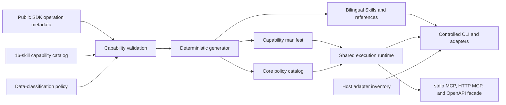

# Architecture

[English](architecture.md) | [简体中文](architecture.zh-CN.md)

## Purpose

UnifyPort Agent Skills turns public SDK operation metadata into task-oriented, policy-aware capabilities for AI agents. It separates public wire metadata from agent behavior: generated artifacts preserve the declared operation identity, while skills and adapters decide how an operation may be invoked safely.

The architecture targets three delivery surfaces:

- A CLI for terminal automation and secure interactive workflows.
- An MCP server for model-safe tools.
- Host/platform adapters that install canonical Skill assets or provide an explicit integration recipe.

## Current status

The current capability catalog assigns all 64 operations exported by the public SDK to exactly one of 16 task Skills. The repository implements catalog validation, data classification, deterministic Skill and policy generation, a shared execution runtime, a controlled CLI, stdio MCP, an authenticated Streamable HTTP gateway with a policy-gated OpenAPI facade, adapter source, bilingual-document checks, source/generated public scanning, npm tarball scanning, and full patch-history scanning.

These components are implemented and tested in source but are not yet published to npm. Directory adapter tests are local integration evidence, not proof of end-to-end behavior in a vendor-hosted environment. TRAE, Dify, and Coze also have different delivery boundaries from native directory Skills.

## Architectural principles

1. **Public metadata first.** Operation identity and wire metadata come from the pinned public SDK dependency.
2. **One operation, one owner.** Each public `operationId` belongs to exactly one task skill.
3. **One runtime, multiple adapters.** CLI, MCP, and host adapters share request, error, timeout, redaction, and policy behavior. Retry and pagination metadata guide explicit caller-owned control rather than hidden runtime loops.
4. **Secrets stay out of model context.** Secret-bearing operations use secure channels even though they remain part of full operation coverage.
5. **Fail closed.** Unknown operations, missing classifications, stale generation, unsafe public content, and unsupported adapters stop generation or execution.
6. **Current status is explicit.** Roadmap capabilities are never presented as shipped behavior.

## System view



The generator consumes only public SDK metadata and reviewed repository policies. Non-public contract inputs, source locations, and synchronization artifacts are outside this repository's public boundary and must not enter Git history.

## Metadata and generation layer

### Public SDK metadata

The pinned public SDK exports the current operation inventory and public metadata used here, including operation IDs, methods, paths, mutability, retryability, and secret-input or secret-output flags. The repository does not duplicate a non-public API contract.

`pnpm capabilities:check` fails closed when:

- A catalog operation is unknown to the public SDK or an SDK operation is unassigned.
- An operation is assigned more than once or the expected 64-operation and 16-skill counts drift.
- Catalog access weakens the SDK mutability classification.
- A mutation lacks the required confirmation classification.
- SDK secret flags do not map to a secure channel and classified data pointer.
- The data policy references an unknown operation or does not default to `internal_only`.

### Capability catalog and generated manifest

The reviewed capability catalog owns task grouping and safety policy. The generated capability manifest combines it with public SDK metadata. Each generated record includes:

- `operationId`
- task-skill owner
- MCP tool name
- public HTTP method and path
- access and confirmation classification
- channel classification
- retryability
- SDK secret-input and secret-output flags

The generated core policy catalog also attaches classified input and output pointers. These files let later runtime and adapter work consume one reviewed policy source without deriving safety rules from prose.

### Deterministic generation

The current generator produces the capability manifest, the core policy catalog, and four bilingual Skill/reference documents for each workflow. Generated output is never edited manually. `pnpm generate:check` rebuilds the expected content in memory and fails when a generated file is missing or stale.

`pnpm capabilities:check` compares catalog ownership with the public SDK operation inventory. The current invariant is:

```text
public operations = 64
owned operations = 64
missing ownership = 0
duplicate ownership = 0
```

## Task-skill layer

The 16 skills are listed in the repository README. They group operations by user intent rather than copying API tags mechanically. A skill contains:

- Task framing and reviewed workflow guidance.
- A credential and untrusted-data boundary.
- An operation allowlist with public method, path, access, confirmation, and channel metadata.
- Generated MCP tool and CLI command mappings consumed by the current adapters.
- Retry guidance derived from public SDK metadata.

Skills do not store API keys, create independent transport behavior, or widen the runtime or MCP policy.

### Cross-skill dependencies

```text
workspace overview
  -> account lifecycle
     -> account authentication
        -> account runtime
           -> conversations -> conversation state / labels / messages
           -> contacts -> contact controls
           -> groups -> group administration

webhook endpoint configuration
  -> independently operated receiver
     -> delivery status, authorization events, join requests, reply handles
```

Dependencies are references, not duplicate ownership. For example, a message skill may consume a conversation identifier discovered by another skill, but the conversation-list operation remains owned only by the explorer skill.

## Shared execution runtime

The source implementation uses one operation executor:

```text
execute(operationId, validatedInput, executionContext)
```

Its responsibilities are:

1. Resolve approved release configuration.
2. Read `UNIFYPORT_API_KEY` from the process or host secret store.
3. Validate input against public SDK types and generated policy metadata.
4. Evaluate adapter exposure, provider limitations, secret policy, and confirmation requirements.
5. Execute the public API request.
6. Parse the common success or stable-error envelope.
7. Apply request timeout and surface retryability/pagination guidance to the caller.
8. Redact diagnostics and shape an adapter-safe result.

The runtime never accepts an arbitrary URL from model output and resolves operation names only through the generated public policy catalog.

### Reliability policy

- Every runtime SDK invocation uses `retry: false`; the runtime never retries automatically.
- A caller may explicitly retry an allowed read only under its own strict attempt/time bound.
- Writes are not retried automatically without an operation-specific idempotency guarantee.
- The runtime does not auto-paginate. Callers explicitly advance public cursors and enforce page/item ceilings.
- Asynchronous operations report accepted or pending state accurately; they do not claim final delivery or authorization prematurely.
- Provider limitations are surfaced explicitly rather than silently dropping fields or simulating success.

## Adapter layer

The generated host inventory records an explicit installation mode and is consumed by the source implementation. Eight hosts use the guarded directory installer; OpenClaw uses CLI staging and instructions; TRAE uses manual import; Dify and Coze use platform integration recipes. The source is implemented and locally tested but remains unpublished, and the inventory is not evidence of vendor-hosted end-to-end validation. See [Adapter support](adapters.md).

### CLI

The controlled CLI is the preferred surface for secure interactive operations. It reads the API key from `UNIFYPORT_API_KEY`, accepts additional secrets through validated environment references, and writes one-time secret output only to a pre-reserved `0600` file. Secrets are not accepted through ordinary command arguments because process listings and shell history may expose them.

The CLI represents all 64 operations. Writes require both the generated policy and `UNIFYPORT_ALLOW_WRITES=true`; destructive operations additionally require `UNIFYPORT_ALLOW_DESTRUCTIVE=true`. Confirmation and risk acceptance are evaluated separately from secret handling.

### MCP and OpenAPI facade

MCP is a model-visible boundary. The implemented server exposes only operations whose released SDK policy and current permission switches allow model-safe input and redacted output. Full 64-operation ownership does not require 64 raw MCP tools.

By default, stdio MCP and Streamable HTTP expose only `getWorkspace`, `listApiKeys`, and `listProviderRegions`. Exact `UNIFYPORT_ALLOW_WRITES=true` adds `updateApiKeyStatus`; the other 60 operations remain controlled CLI/Skill workflows. Raw secret fields must not appear in MCP schemas, tool calls, tool results, traces, or model context.

The HTTP gateway also serves `GET /openapi.json` and policy-gated `POST /tools/<tool-name>`. The OpenAPI document projects the current MCP registry, so it has the same three-tool default and four-tool explicit-write boundary; it is not a raw 64-operation API. Tool execution and MCP requests require a Bearer Device API key. The schema and health endpoints do not execute Device API operations.

The gateway binds to loopback by default. A non-loopback bind additionally requires an explicit public flag, an exact host allowlist, and directly configured TLS certificate/key files. The optional origin allowlist rejects requests carrying an unapproved `Origin` header, but the gateway emits no CORS response headers and does not enable browser CORS. Request-size and header limits, timeouts, and a concurrency ceiling further constrain the remote boundary.

### Host adapters

A host adapter translates canonical assets into one of four explicit delivery modes:

- Guarded project/user directory installation for eight Skill-aware hosts.
- OpenClaw CLI staging and installation instructions.
- TRAE manual import.
- Dify Streamable HTTP MCP provider and Coze custom OpenAPI integration recipes.

These modes do not make Dify or Coze native Agent Skills, do not make TRAE a directory install, and do not bypass the shared runtime. If a host or platform cannot meet an operation's security requirements, the adapter must mark it unsupported or route the user to the controlled CLI.

## Trust boundaries

| Boundary              | Status             | Trusted input                                         | Prohibited behavior                                             |
| --------------------- | ------------------ | ----------------------------------------------------- | --------------------------------------------------------------- |
| Capability validation | Current            | Public SDK metadata and reviewed catalogs             | Unknown or unassigned operations; weakened safety policy        |
| Generator             | Current            | Validated catalog and data policy                     | Network-dependent, stale, or manually edited generation         |
| Public scanners       | Current            | Source, generated output, npm tarballs, patch history | Treating scanner passes as approval for contextual private data |
| Shared runtime        | Source implemented | Generated operation policy and validated user input   | Arbitrary URL or arbitrary operation execution                  |
| MCP/OpenAPI facade    | Source implemented | Fixed model-safe schemas and redacted results         | Secrets, the 60 CLI-only operations, or unbounded tools         |
| CLI                   | Source implemented | Authorized terminal and secure input/output channel   | Secrets in argv, logs, or shell history                         |
| Host adapter          | Source implemented | Generated canonical assets and reviewed target mode   | Claiming vendor E2E validation or bypassing runtime policy      |
| Public release        | Current governance | Reviewed source and generated artifacts               | Local paths, private infrastructure, credentials, or PII        |

## Roadmap

- Publish verified npm artifacts for the implemented runtime and CLI/MCP package.
- Complete vendor-hosted adapter verification and publish a tested support manifest.
- Add an approved sanitizer and full structural parity checks if a standalone public contract artifact is introduced.
- Publish machine-readable provider capability and adapter support matrices.
- Add durable, cancellable host workflows for approved asynchronous operations.
- Add signed release provenance and reproducible package verification.
- Introduce additional secure-channel integrations without expanding model-visible secret surfaces.
