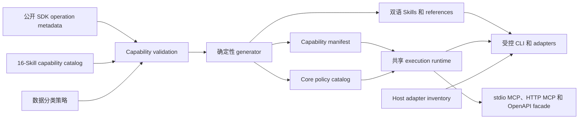

# 架构

[English](architecture.md) | [简体中文](architecture.zh-CN.md)

## 目标

UnifyPort Agent Skills 将公开 SDK operation metadata 转换为面向 AI agent 的任务型、策略感知能力。架构将公开 wire metadata 与 agent behavior 分离：生成产物保持声明的 operation identity，Skills 和 adapters 决定 operation 可以如何安全调用。

架构面向三种交付方式：

- 用于终端自动化和安全交互流程的 CLI。
- 用于模型安全工具的 MCP server。
- 安装 canonical Skill assets 或提供明确 integration recipe 的 host/platform adapters。

## 当前状态

当前 capability catalog 将公开 SDK 导出的 64 个 operations 全部唯一分配给 16 个任务型 Skills。仓库已实现 catalog validation、数据分类、确定性 Skill 与 policy 生成、共享 execution runtime、受控 CLI、stdio MCP、带 policy-gated OpenAPI facade 的鉴权 Streamable HTTP gateway、adapter source、双语文档检查、source/generated public scanning、npm tarball scanning 和完整 patch-history scanning。

这些组件已经在源码中实现并测试，但尚未发布到 npm。目录 adapter tests 属于本地 integration evidence，不能证明厂商托管环境端到端行为。TRAE、Dify 和 Coze 的交付边界也不同于原生目录 Skills。

## 架构原则

1. **公开 metadata 优先。** Operation identity 和 wire metadata 来自固定版本的公开 SDK dependency。
2. **一个 operation，一个 owner。** 每个公开 `operationId` 只属于一个任务型 Skill。
3. **一个运行时，多种 adapters。** CLI、MCP 和 host adapters 共用请求、错误、timeout、脱敏和策略行为。Retry 与 pagination metadata 用于指导调用方显式控制，不会形成隐藏 runtime loop。
4. **Secrets 不进入模型上下文。** 含 secret 的 operations 仍属于完整覆盖范围，但必须使用安全通道。
5. **Fail closed。** 未知 operation、缺失分类、过期生成产物、不安全公开内容和不受支持 adapter 都必须阻止生成或执行。
6. **明确标注当前状态。** Roadmap capability 不能被描述为已经发布。

## 系统视图



Generator 只读取公开 SDK metadata 和仓库中经过评审的 policies。非公开 contract input、source location 和 synchronization artifact 位于本仓库公开边界之外，不能进入 Git 历史。

## Metadata 与生成层

### 公开 SDK metadata

固定版本的公开 SDK 导出本仓库使用的当前 operation inventory 和公开 metadata，包括 operation IDs、methods、paths、mutability、retryability，以及 secret-input 或 secret-output flags。本仓库不复制非公开 API contract。

以下情况会使 `pnpm capabilities:check` fail closed：

- Catalog operation 不存在于公开 SDK，或 SDK operation 未分配。
- Operation 重复分配，或者预期的 64-operation、16-Skill 数量发生漂移。
- Catalog access 弱化 SDK mutability classification。
- Mutation 缺少所需 confirmation classification。
- SDK secret flag 没有映射到安全通道和已分类 data pointer。
- Data policy 引用了未知 operation，或者默认值不是 `internal_only`。

### Capability catalog 与生成 manifest

经过评审的 capability catalog 负责任务分组和安全策略。生成 capability manifest 将它与公开 SDK metadata 合并，每条生成记录包含：

- `operationId`
- 任务型 Skill owner
- MCP tool name
- 公开 HTTP method 和 path
- access 与 confirmation classification
- channel classification
- retryability
- SDK secret-input 和 secret-output flags

生成 core policy catalog 还会附加已分类的 input 和 output pointers。后续 runtime 和 adapter 可以消费同一个经过评审的策略来源，不必从 prose 推导安全规则。

### 确定性生成

当前 generator 生成 capability manifest、core policy catalog，以及每个 workflow 对应的四份双语 Skill/reference 文档。生成产物禁止手工编辑。`pnpm generate:check` 会在内存中重建预期内容，并在生成文件缺失或过期时失败。

`pnpm capabilities:check` 将 catalog ownership 与公开 SDK operation inventory 比较。当前不变量为：

```text
public operations = 64
owned operations = 64
missing ownership = 0
duplicate ownership = 0
```

## 任务型 Skill 层

16 个 Skills 列在仓库 README 中。它们按用户意图组织 operations，而不是机械复制 API tags。一个 Skill 包含：

- 任务定义和经过评审的 workflow guidance。
- 凭证与不可信数据边界。
- 包含公开 method、path、access、confirmation 和 channel metadata 的 operation allowlist。
- 当前 adapters 使用的生成 MCP tool 和 CLI command mappings。
- 从公开 SDK metadata 派生的 retry guidance。

Skills 不存储 API Key、不创建独立 transport behavior，也不能扩大 runtime 或 MCP policy。

### 跨 Skill 依赖

```text
workspace overview
  -> account lifecycle
     -> account authentication
        -> account runtime
           -> conversations -> conversation state / labels / messages
           -> contacts -> contact controls
           -> groups -> group administration

webhook endpoint configuration
  -> 独立运行的 receiver
     -> delivery status、authorization events、join requests、reply handles
```

依赖关系通过 reference 表达，不能形成重复 ownership。例如 message Skill 可以使用另一个 Skill 发现的 conversation identifier，但会话列表 operation 仍只属于 explorer Skill。

## 共享执行运行时

源码实现使用一个 operation executor：

```text
execute(operationId, validatedInput, executionContext)
```

它负责：

1. 解析经批准的 release configuration。
2. 从进程或 host secret store 读取 `UNIFYPORT_API_KEY`。
3. 根据公开 SDK types 和生成 policy metadata 校验输入。
4. 判断 adapter exposure、provider limitations、secret policy 和 confirmation requirements。
5. 执行公开 API 请求。
6. 解析通用成功或稳定错误 envelope。
7. 应用 request timeout，并向调用方提供 retryability/pagination guidance。
8. 对诊断信息脱敏，并生成适合 adapter 的结果。

Runtime 绝不接受由模型输出的任意 URL，并且只通过生成的公开 policy catalog 解析 operation name。

### 可靠性策略

- 每次 runtime SDK invocation 都使用 `retry: false`；runtime 绝不自动重试。
- 调用方只有在严格限制自身 attempt/time 时，才可显式重试 policy 允许的 read。
- 写操作没有 operation-specific 幂等保证时不得自动重试。
- Runtime 不会自动分页。调用方必须显式推进公开 cursor，并限制 page/item 上限。
- 异步 operation 必须准确报告 accepted 或 pending，不能提前宣称最终投递或授权成功。
- Provider limitations 必须明确返回，不能静默丢字段或伪造成功。

## Adapter 层

生成 host inventory 记录明确的 installation mode，并由源码实现消费。8 个 hosts 使用受保护目录 installer；OpenClaw 使用 CLI staging 和 instructions；TRAE 使用手工导入；Dify 和 Coze 使用 platform integration recipes。源码已实现并通过本地测试，但尚未发布；inventory 也不能证明厂商托管环境端到端验证。详见 [Adapter 支持](adapters.zh-CN.md)。

### CLI

受控 CLI 是安全交互操作的首选入口。它从 `UNIFYPORT_API_KEY` 读取 API Key，通过经过校验的环境引用接收额外 secrets，并且只把一次性 secret output 写入预留的 `0600` 文件。Secrets 不能通过普通命令参数传入，因为 process listing 和 shell history 可能暴露它们。

CLI 表示全部 64 个 operations。写操作同时要求生成策略和 `UNIFYPORT_ALLOW_WRITES=true`；destructive 操作还要求 `UNIFYPORT_ALLOW_DESTRUCTIVE=true`。Confirmation 和 risk acceptance 与 secret handling 分别判断。

### MCP 与 OpenAPI facade

MCP 是模型可见边界。已实现 server 只暴露 released SDK policy 和当前 permission switches 共同允许的 model-safe input 与脱敏 output。完整 64-operation ownership 不要求提供 64 个原始 MCP tools。

stdio MCP 与 Streamable HTTP 默认只暴露 `getWorkspace`、`listApiKeys` 和 `listProviderRegions`。精确设置 `UNIFYPORT_ALLOW_WRITES=true` 后增加 `updateApiKeyStatus`；其余 60 个 operations 仍属于受控 CLI/Skill workflows。原始 secret 字段不得进入 MCP schemas、tool calls、tool results、traces 或模型上下文。

HTTP gateway 还提供 `GET /openapi.json` 和 policy-gated `POST /tools/<tool-name>`。OpenAPI document 投影当前 MCP registry，因此保持同一组默认 3 个 tools、显式开启 writes 后 4 个 tools 的边界；它不是包含 64 个 operations 的原始 API。Tool execution 和 MCP requests 要求 Bearer Device API Key；schema 和 health endpoints 不执行 Device API operation。

Gateway 默认只绑定 loopback。绑定非 loopback 地址还要求显式 public flag、精确 host allowlist，以及直接配置的 TLS certificate/key 文件。可选 origin allowlist 会拒绝携带未批准 `Origin` header 的请求，但 gateway 不返回 CORS response headers，也不会启用 browser CORS。Request-size 与 header limits、timeouts 和并发上限进一步约束远程边界。

### Host adapters

Host adapter 将 canonical assets 转换为四种明确交付模式：

- 面向 8 个 Skill-aware hosts 的受保护 project/user 目录安装。
- OpenClaw CLI staging 与安装 instructions。
- TRAE 手工导入。
- Dify Streamable HTTP MCP provider 与 Coze custom OpenAPI integration recipes。

这些模式不会让 Dify 或 Coze 变成原生 Agent Skills，不会把 TRAE 变成目录安装，也不会绕过共享 runtime。如果 host 或 platform 无法满足某个 operation 的安全要求，adapter 必须将其标记为不支持或引导用户使用受控 CLI。

## 信任边界

| 边界                  | 状态       | 可信输入                                       | 禁止行为                                        |
| --------------------- | ---------- | ---------------------------------------------- | ----------------------------------------------- |
| Capability validation | 当前       | 公开 SDK metadata 和经过评审的 catalogs        | 未知或未分配 operation；弱化安全策略            |
| Generator             | 当前       | 已验证 catalog 和 data policy                  | 依赖网络、过期或手工编辑的生成结果              |
| Public scanners       | 当前       | Source、生成输出、npm tarballs、patch history  | 把 scanner 通过视为上下文相关私有数据的公开授权 |
| 共享运行时            | 源码已实现 | 生成 operation policy 和已验证用户输入         | 执行任意 URL 或任意 operation                   |
| MCP/OpenAPI facade    | 源码已实现 | 固定 model-safe schemas 和脱敏结果             | Secrets、60 个 CLI-only operations 或无界 tools |
| CLI                   | 源码已实现 | 已授权终端和安全输入/输出通道                  | Secrets 进入 argv、日志或 shell history         |
| Host adapter          | 源码已实现 | 生成 canonical assets 和经过评审的 target mode | 声称厂商 E2E 验证或绕过 runtime policy          |
| 公开 release          | 当前治理   | 已评审 source 和生成产物                       | 本机路径、私有基础设施、凭证或 PII              |

## Roadmap

- 为已实现的 runtime 和 CLI/MCP package 发布经过验证的 npm artifacts。
- 完成厂商托管环境 adapter 验证，并发布经过测试的 support manifest。
- 如果引入独立公开 contract artifact，增加经批准的 sanitizer 和完整 structural parity checks。
- 发布机器可读的 provider capability 和 adapter support matrices。
- 为经批准的异步 operations 增加持久、可取消的 host workflows。
- 增加 signed release provenance 和可复现 package verification。
- 在不扩大模型可见 secret surface 的前提下增加安全通道集成。
